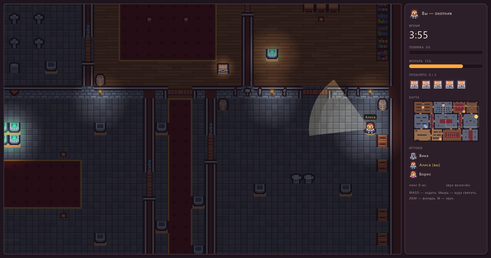
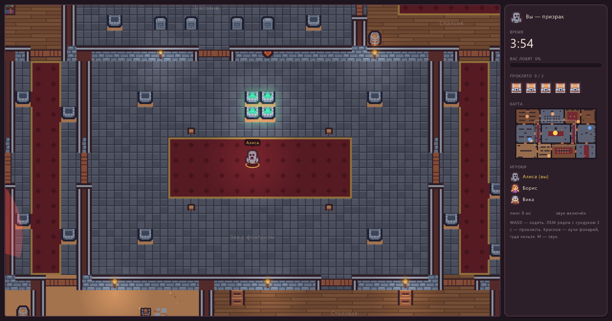
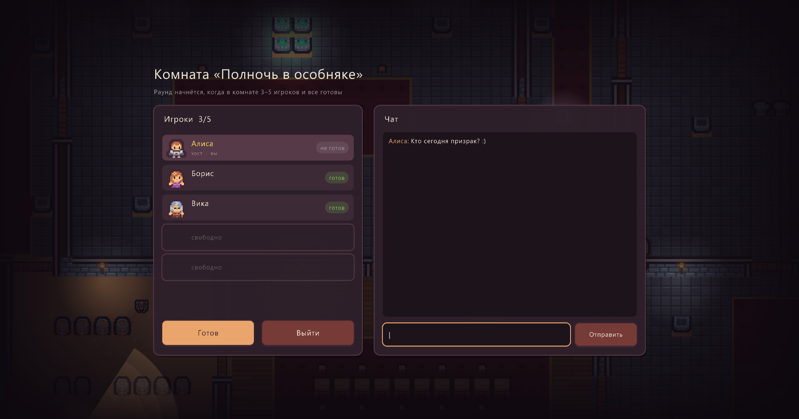
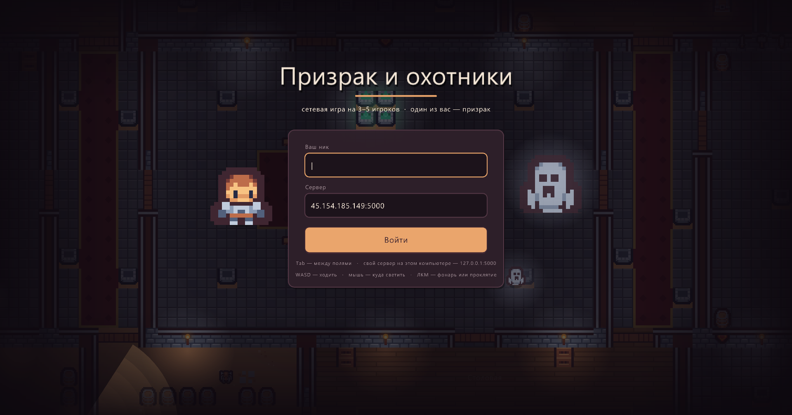
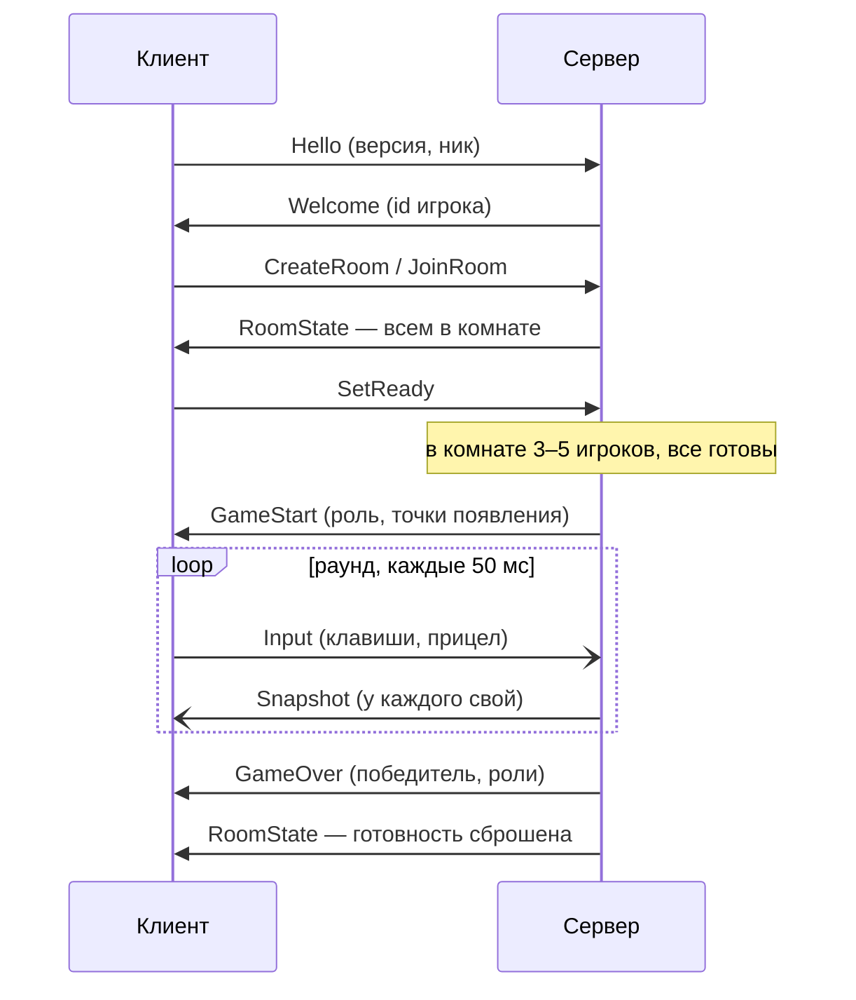
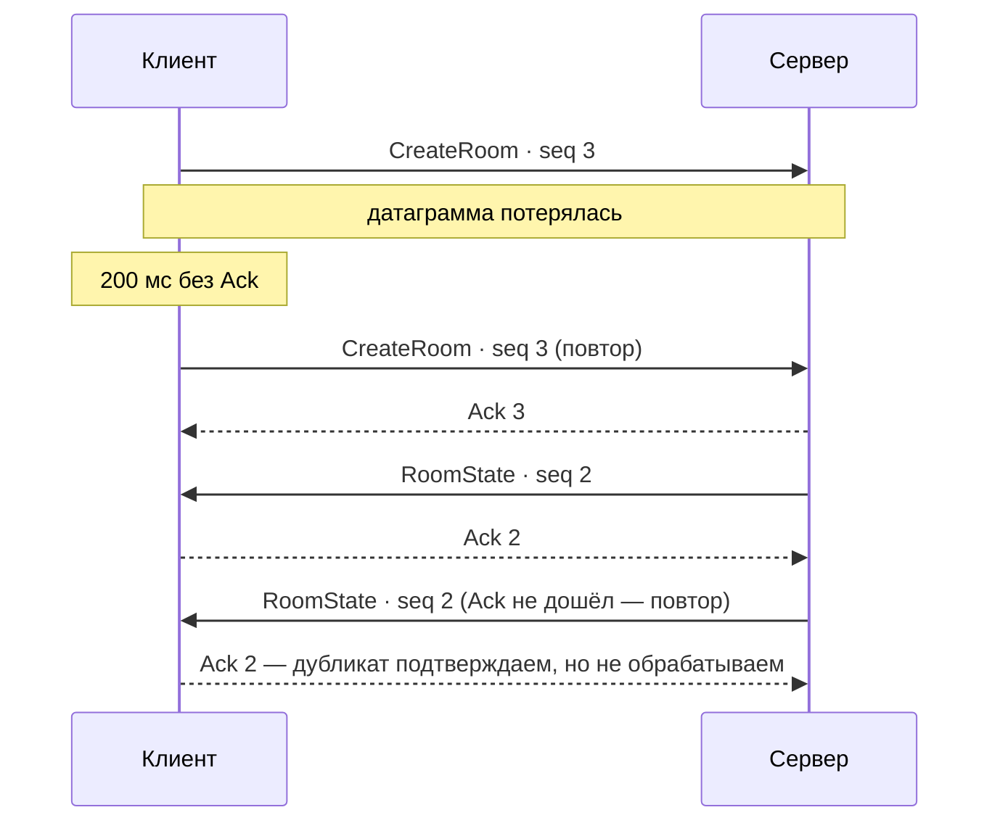

<h1 align="center">👻 Призрак и охотники</h1>

<p align="center">
  <b>Сетевая игра на 3–5 игроков в тёмном особняке.</b><br>
  Один из вас — невидимый призрак, остальные — охотники с фонарями.
</p>

<p align="center">
  
  
  
  
  
</p>

<p align="center">
  
</p>

Сеть написана с нуля: голый `Socket` поверх UDP, свой бинарный протокол и свой надёжный канал
с подтверждениями и повторами. Никаких готовых сетевых библиотек, JSON и `UdpClient`.

---

## Об игре

Особняк из 11 комнат: библиотека, часовня, лаборатория, зал с фонтаном, оружейная… Везде темно,
светят только факелы и фонари охотников. В комнатах стоят 5 сундуков.

| | 👻 Призрак | 🔦 Охотники |
|---|---|---|
| **Видит** | весь особняк, всех охотников и их лучи (красным) | друг друга и то, что попало в луч фонаря |
| **Скорость** | 4,5 клетки/с | 4 клетки/с |
| **ЛКМ** | проклинать сундук: стоять рядом и держать 3 с (можно с перерывами — прогресс не сгорает) | фонарь: конус 5 клеток и 60°, стены и шкафы его загораживают |
| **Побеждает, если** | проклял 3 сундука из 5 **или** продержался 4 минуты | призрак суммарно 3 с простоял в лучах фонарей |

Пара деталей, из-за которых играть интереснее:

- **Туман войны на сервере.** Охотникам сервер просто не присылает координаты призрака, пока его не
  осветили, — подсмотреть их в трафике или в памяти клиента не получится.
- **Фонарь перегревается.** 6 секунд непрерывного света — и он гаснет, пока не остынет до конца.
  Перед этим начинает мигать. Нельзя просто встать у сундука и светить на него весь раунд.
- **Поимка не мгновенная.** Вне луча шкала поимки спадает: призрак может вырваться.
- **Мини-карта** показывает сундуки; тот, который проклинают прямо сейчас, пульсирует — охотники
  видят, куда бежать.

<table>
  <tr>
    <td width="50%"></td>
    <td width="50%"></td>
  </tr>
  <tr>
    <td align="center"><sub>Призрак видит весь особняк; красное — лучи охотников</sub></td>
    <td align="center"><sub>Комната: готовность игроков и чат</sub></td>
  </tr>
</table>

### Управление

| Клавиша | Охотник | Призрак |
|---|---|---|
| <kbd>W</kbd> <kbd>A</kbd> <kbd>S</kbd> <kbd>D</kbd> | ходить | ходить |
| Мышь | куда светить | — |
| <kbd>ЛКМ</kbd> | фонарь (держать) | проклинать сундук (держать рядом с ним) |
| <kbd>M</kbd> | звук вкл/выкл | звук вкл/выкл |

---

## Быстрый старт

Нужен [.NET 10 SDK](https://dotnet.microsoft.com/download). Клиент проверялся на Windows.

### Сыграть на готовом сервере

```bash
dotnet run --project GhostGame.Client
```

Ввести ник и нажать «Войти» — в поле «Сервер» уже стоит адрес нашего сервера.
Дальше: создать комнату или зайти в чужую, нажать «Готов». Раунд начнётся, когда в комнате
3–5 игроков и все готовы.

<p align="center"></p>

### Свой сервер на этом компьютере

```bash
dotnet run --project GhostGame.Server
```

Сервер слушает UDP-порт 5000 (другой порт — аргументом: `dotnet run --project GhostGame.Server -- 6000`).
В клиенте в поле «Сервер» указать `127.0.0.1:5000` — или сразу запустить его с адресом:

```bash
dotnet run --project GhostGame.Client -- 127.0.0.1 5000
```

Друзья в той же сети вводят IP твоего компьютера. Если не подключаются — разреши входящий
**UDP** 5000 в брандмауэре Windows.

### Сервер на VPS в Docker

В репозитории есть `Dockerfile` и `compose.yaml`: образ сам собирает сервер из исходников,
.NET на сервере не нужен.

```bash
git clone https://github.com/Hopih/GhostGame.git && cd GhostGame
docker compose up -d --build
docker compose logs -f        # должно быть «Server listening on UDP port 5000»
```

- Порт пробрасывается как `5000:5000/udp` — без `/udp` Docker открыл бы только TCP.
- `restart: unless-stopped` — после падения или перезагрузки VPS сервер поднимется сам.
- Сервер работает не от root и ограничен 256 МБ памяти.
- Обновить после `git push`: `git pull && docker compose up -d --build`.
- Если у хостинга есть свой файрвол — открыть в нём входящий UDP 5000.

### Готовый клиент для друзей

```bash
dotnet publish GhostGame.Client -c Release -r win-x64 --self-contained true -p:PublishSingleFile=true -p:IncludeNativeLibrariesForSelfExtract=true
```

В `GhostGame.Client/bin/Release/net10.0/win-x64/publish/` появятся `GhostGame.Client.exe`
(.NET уже внутри), папка `assets` и `map.txt`. Отдавать нужно всё вместе одним архивом.

---

## Как это устроено

Одна партия глазами сети (сплошная стрелка — надёжный пакет, открытая — без гарантий):



- **Сервер авторитарный.** Клиент шлёт только нажатые клавиши и точку прицела, сервер сам двигает
  игроков, проверяет стены, считает лучи, поимку и проклятия и рассылает каждому свой Snapshot.
- **Клиент не тормозит из-за сети.** Сокет читает отдельная задача и складывает пакеты в очередь;
  главный поток Raylib раз в кадр забирает их без ожидания и рисует 60 кадров в секунду. Между
  снимками сервера позиции плавно интерполируются. Повторы надёжного канала — ещё одна задача, раз в 50 мс.
- **Потоки на сервере.** Цикл приёма пакетов, фоновая задача (таймауты и повторы) и по игровому
  циклу на каждую комнату. Состояние раунда меняется под `lock`, комнаты — под `SemaphoreSlim`.
  Правило: внутри блокировки только решаем, отправляем — после неё.

### Протокол

Каждая датаграмма — заголовок 7 байт и полезная нагрузка, всего не больше 1200 байт
(чтобы не дробиться в сети). Все числа — big-endian, строки — UTF-8 с длиной в 2 байта.

| Байты | Поле | |
|---|---|---|
| 0–1 | magic | `0x4748` («GH») — чужие датаграммы отсекаются сразу |
| 2 | тип | один из типов ниже; неизвестный — пакет выбрасывается |
| 3–6 | seq | номер в надёжном канале, `0` — для пакетов без гарантий |
| 7… | payload | своя для каждого типа (`Shared/Packets.cs`) |

<details>
<summary><b>Все типы пакетов</b></summary>

| Код | Пакет | Куда | Надёжно | Что внутри |
|---|---|---|:---:|---|
| `0x01` | Hello | → сервер | ✅ | версия протокола, ник |
| `0x02` | Ping | → сервер | — | время отправки |
| `0x03` | ClientDisconnect | → сервер | — | пусто, шлётся 3 раза |
| `0x10` | ListRooms | → сервер | ✅ | пусто |
| `0x11` | CreateRoom | → сервер | ✅ | название |
| `0x12` | JoinRoom | → сервер | ✅ | id комнаты |
| `0x13` | LeaveRoom | → сервер | ✅ | пусто |
| `0x14` | SetReady | → сервер | ✅ | пусто (переключает готовность) |
| `0x15` | Chat | → сервер | ✅ | текст |
| `0x20` | Input | → сервер | — | номер, движение X/Y, прицел X/Y, кнопки — 15 байт |
| `0x7F` | Ack | ⇄ | — | какой seq подтверждаем |
| `0x81` | Welcome | → клиент | ✅ | id игрока |
| `0x82` | Pong | → клиент | — | время из Ping |
| `0x83` | ServerDisconnect | → клиент | — | причина: таймаут / сервер выключается |
| `0x90` | RoomList | → клиент | ✅ | комнаты: id, название, игроков, идёт ли раунд |
| `0x91` | RoomState | → клиент | ✅ | комната, хост, игроки и их готовность |
| `0x95` | ChatMessage | → клиент | ✅ | автор, текст |
| `0xA0` | GameStart | → клиент | ✅ | твоя роль, длина раунда, точки появления |
| `0xA1` | Snapshot | → клиент | — | состояние раунда (ниже) |
| `0xA3` | GameOver | → клиент | ✅ | победитель, причина, роли всех игроков |
| `0xF0` | Error | → клиент | ✅ | код, текст (ник занят, комната полна…) |

</details>

<details>
<summary><b>Snapshot по байтам</b></summary>

| Поле | Размер |
|---|---|
| tick | 4 |
| оставшееся время, с | 2 |
| число игроков N | 1 — всегда 13-й байт датаграммы |
| N × игрок: id, x, y, прицел x, прицел y, флаги, заряд фонаря | N × 22 |
| маска проклятых сундуков (бит на сундук) | 1 |
| прогресс поимки, % | 1 |
| прогресс проклятия каждого сундука, % | 5 |

Флаги игрока: бит 0 — фонарь горит, бит 1 — фонарь перегрелся.
Охотнику призрак попадает в список, только когда его осветили.

</details>

### Надёжный канал

Лобби, чат, старт и итоги не должны теряться, поэтому идут через `ReliableChannel` — свой TCP в миниатюре:



- у каждого надёжного пакета свой `seq`, получатель отвечает `Ack`;
- без `Ack` дольше 200 мс — повтор; не подтвердили 10 с — собеседник считается отключённым;
- дубликаты подтверждаются ещё раз и выбрасываются;
- пришедшие раньше времени ждут в буфере (до 64 пакетов) и отдаются строго по порядку.

Движение и снимки идут **без гарантий**: потерянный Snapshot не нужен — через 50 мс придёт свежий.

### Устойчивость

- **Таймауты.** Клиент шлёт Ping раз в секунду. Сервер 10 с не слышит игрока — выкидывает его из
  комнаты и шлёт `ServerDisconnect` три раза (хоть один дойдёт). Клиент 5 с не слышит сервер —
  «Соединение потеряно».
- **Мусор не роняет сервер.** Чужой magic, неизвестный тип, обрезанная нагрузка — датаграмма
  отбрасывается с записью в лог. Пакеты от незнакомого адреса, кроме Hello, молча игнорируются.
- **Лимиты.** До 8 комнат по 5 игроков, 40 подключений; ник 3–16 символов, проверка версии протокола.

---

## Карта

Особняк хранится в обычном текстовом файле [`GhostGame.Shared/map.txt`](GhostGame.Shared/map.txt):
64×40 символов, по символу на клетку. Его читают и сервер (стены, лучи, точки появления), и клиент
(отрисовка). Поменял файл — поменялась карта.

| Символы | Что это |
|---|---|
| `#` `W` `V` `Y` `E` | стены |
| `B` `K` `S` | высокая мебель — не пройти и **загораживает свет** |
| `T` `P` `b` `X` `R` `O` `N` `A` `F` | низкая мебель — не пройти, но свет проходит |
| `.` `,` `=` `~` `D` `c` `s` | полы, ковры, двери, декор — можно ходить |
| `1`–`5` | сундуки |
| `G` / `H` | где появляются призрак и охотники |
| `@x y Название` | подпись комнаты (строки после сетки) |

---

## Структура проекта

```
GhostGame/
├── GhostGame.Shared/          общий код клиента и сервера
│   ├── PacketIO.cs            заголовок датаграммы: magic, тип, seq
│   ├── PacketWriter.cs        числа и строки → байты (и PacketReader обратно)
│   ├── Packets.cs             Write…/Read… для каждого типа пакета
│   ├── Transport.cs           отправка датаграмм через Socket
│   ├── ReliableChannel.cs     надёжный канал: seq, Ack, повторы, порядок
│   ├── GameMap.cs, map.txt    карта особняка
│   ├── Flashlight.cs          попадает ли точка в луч (со стенами и шкафами)
│   └── GameTypes.cs …         Input, Snapshot, комнаты, коды ошибок
├── GhostGame.Server/
│   ├── Program.cs             приём пакетов, сессии, лобби, таймауты
│   ├── Room.cs                комната и игровой цикл раунда
│   ├── ClientSession.cs       одно подключение: адрес, ник, канал
│   └── PlayerState.cs         игрок в раунде: позиция, ввод, фонарь
├── GhostGame.Client/
│   ├── Program.cs             главный цикл Raylib, сеть, переходы между экранами
│   ├── GameScreen.cs          раунд: интерполяция снимков, ввод, камера
│   ├── Screens/               вход, лобби, комната, итоги
│   ├── Graphics/              карта, свет и темнота, игроки, HUD, мини-карта, фон меню
│   ├── Audio/                 звуки шагов, дверей, фонаря, проклятий
│   └── assets/                спрайты и звуки
├── Dockerfile, compose.yaml   сервер в контейнере
└── ТЗ «Призрак и охотники» — UDP.docx
```

---

## Авторы и ресурсы

- Код — **[Hopih](https://github.com/Hopih)**, семестровый проект по сетевому программированию.
- Спрайты — [Kenney Tiny Dungeon](https://kenney.nl/assets/tiny-dungeon), звуки — паки
  [Kenney](https://kenney.nl/assets) (RPG Audio и др.). Всё под лицензией CC0, файлы лицензий лежат в
  `GhostGame.Client/assets`.
- Окно и графика — [Raylib-cs](https://github.com/ChrisDill/Raylib-cs).
